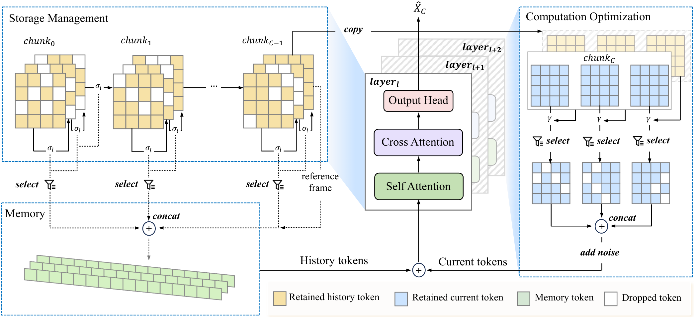

<div align="center">

#  Dynamics-Aware Sparse Attention for Efficient Autoregressive Video Diffusion

[](DASA/requirements.txt)
[](https://arxiv.org/abs/2610.26262)
[](https://yuanyu0.github.io/DASA/)

<strong>Yuanyu He<sup>1,2*</sup> · Zhuokun Chen<sup>3*</sup> · Yefei He<sup>1†</sup> · Zhiwei Tang<sup>2</sup> · Jiasheng Tang<sup>2</sup> · Yinghao Yu<sup>2</sup> · Jianfei Cai<sup>3</sup> · Bohan Zhuang<sup>1‡</sup></strong><br>
<sup>1</sup> Zhejiang University &nbsp; <sup>2</sup> Alibaba Group &nbsp; <sup>3</sup> Monash University

<sup>*</sup> Equal contribution &nbsp; <sup>†</sup> Project leader &nbsp; <sup>‡</sup> Corresponding author

[Overview](#overview) · [Results](#results) · [Installation](#installation) · [Weights](#model-weights) · [Inference](#inference) · [Training](#training) · [Citation](#citation)

</div>

---

<a id="overview"></a>

## 🔥 Overview

**Dynamics-Aware Sparse Attention (DASA)** accelerates chunk-wise autoregressive video diffusion by exploiting temporal redundancy: stable regions can reuse past features, while memory and denoising effort are focused on tokens that carry new visual information.

<div align="center">

</div>

DASA has two training-free inference components and an optional training adaptation:

- **Frame-wise Memory Management** prunes historical KV tokens with layer-wise similarity thresholds, preserves every token in the last frame as a reference anchor, and refreshes a token after its age reaches the maximum threshold τ. This reduces cache growth while retaining long-range context.
- **Region-level Computation Allocation** locally aligns the current chunk with the reference frame. Tokens whose cosine similarity reaches γ reuse aligned features and exit early; the remaining dynamic regions continue through denoising.
- **Dynamics-Guided Distillation Adaptation** counters the static bias that can arise when feature reuse is exposed during training.

<a id="results"></a>

## 📊 Results

### Video generation on VBench

DASA raises throughput from 18.42 to 26.21 FPS on Self-Forcing (1.42×) and from 18.30 to 26.50 FPS on LongLive (1.45×). VBench total scores remain close to baseline, moving from 84.19 to 83.81 and from 83.16 to 82.72. With dynamics-guided adaptation, throughput reaches 27.58 FPS (1.50×) and 27.91 FPS (1.53×), with total scores of 83.98 and 83.09.

<a id="installation"></a>

## 🛠️ Installation

The pinned environment targets Linux x86_64, Python 3.10, CUDA 12.4, and PyTorch 2.5.1. Start from the repository root and enter `DASA/` for code commands.

```bash
cd DASA
export PYTHONNOUSERSITE=1
conda create -n dasa python=3.10 pip -y
conda activate dasa
pip install -r requirements.txt
```

<a id="model-weights"></a>

## 📦 Model weights

Run these commands from the `DASA/` code directory:

```bash
cd DASA
huggingface-cli download Wan-AI/Wan2.1-T2V-1.3B --local-dir wan_models/Wan2.1-T2V-1.3B
huggingface-cli download gdhe17/Self-Forcing checkpoints/self_forcing_dmd.pt --local-dir .
huggingface-cli download Efficient-Large-Model/LongLive-1.3B --local-dir longlive_models
```

<a id="inference"></a>

## 🎬 Inference

Set `data_path` in each config under `DASA/configs/` to a text file with one prompt per line. DASA parameters are grouped under the `dasa` key.

| Backbone | Inference | Training |
| :--- | :---: | :---: |
| Self-Forcing | [Config](DASA/configs/self_forcing/inference.yaml) | [Config](DASA/configs/self_forcing/finetune.yaml) |
| LongLive | [Config](DASA/configs/longlive/inference.yaml) | [Config](DASA/configs/longlive/finetune.yaml) |

Run from the `DASA/` code directory:

```bash
cd DASA
CUDA_VISIBLE_DEVICES=0 python -m dasa.launch self_forcing inference
CUDA_VISIBLE_DEVICES=0 python -m dasa.launch longlive inference
```

Defaults produce 5-second videos in `DASA/outputs/<backbone>/inference/`. Use `--config_path PATH` to select a custom config.

<a id="training"></a>

## 🚀 Training

Download the 14B teacher and set training prompt paths in the `finetune.yaml` files. Self-Forcing trains full weights; LongLive trains LoRA adapters.

```bash
cd DASA
huggingface-cli download Wan-AI/Wan2.1-T2V-14B --local-dir wan_models/Wan2.1-T2V-14B

CUDA_VISIBLE_DEVICES=0,1,2,3 python -m dasa.launch self_forcing finetune --nproc_per_node 4
CUDA_VISIBLE_DEVICES=0,1,2,3 python -m dasa.launch longlive finetune --nproc_per_node 4
```

Checkpoints are saved in `DASA/outputs/<backbone>/finetune/`. Add `--max_steps N` to limit training steps.

<a id="citation"></a>

## ⭐️ Citation

```bibtex
@article{he2026dynamics,
  title={Dynamics-Aware Sparse Attention for Efficient Autoregressive Video Diffusion},
  author={He, Yuanyu and Chen, Zhuokun and He, Yefei and Tang, Zhiwei and Tang, Jiasheng and Yu, Yinghao and Cai, Jianfei and Zhuang, Bohan},
  journal={arXiv preprint arXiv:2610.26262},
  year={2026}
}
```

## 🤝 Acknowledgements

Built on [Self-Forcing](https://github.com/guandeh17/Self-Forcing), [LongLive](https://github.com/NVlabs/LongLive), [Wan2.1](https://github.com/Wan-Video/Wan2.1) and [CLIP](https://github.com/openai/CLIP). See [NOTICE](DASA/NOTICE) for upstream licenses.
